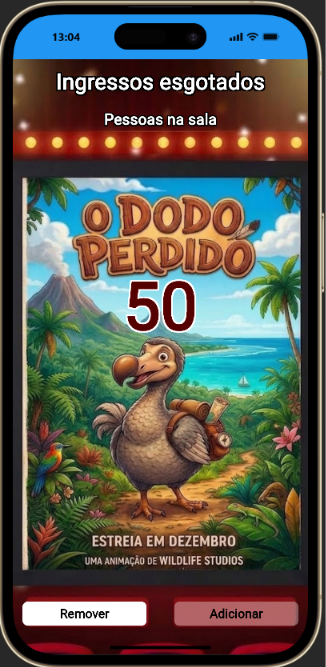

# 🎬 CineDodô Manager - Controle de Acessos 2.0 (Checkpoint 02)

Um aplicativo desenvolvido em **Flutter** para gerenciar a entrada, a saída e a lotação de clientes nas salas de cinema do **CineDodô**. Esta é a versão 2.0, focada no gerenciamento de acessos, regras de negócio rígidas e interface interativa.

## 👥 Integrantes
- Lucas Dudena – RM567600
- Pedro Begali – RM567478

## 📍 Ambiente Escolhido
**Cinema** (Tema Customizado: CineDodô)

## 📋 Descrição do Aplicativo
O CineDodô Manager evoluiu de um simples contador para um sistema completo de gestão de ingressos. O aplicativo permite cadastrar o nome do cliente, atribuir um assento (de 1 a 10) e selecionar o filme desejado, registrando a data e hora de entrada. Através de uma lista interativa, o gestor pode acompanhar quem está na sala, registrar saídas e excluir históricos, tudo com validações rigorosas em tempo real.

## ✨ Novas Funcionalidades (Versão 2.0)

- **Cadastro Completo:** Inserção de Nome, Número do Assento (1 a 10) e escolha do Filme via Dropdown.
- **Lista Interativa (Slidable):** Os registros são listados na tela. Ao deslizar o item para a esquerda, são reveladas as ações de **SAÍDA** e **EXCLUIR**.
- **Controle de Lotação Global e por Sala:** O cinema tem capacidade para 50 pessoas, mas cada sessão/filme possui o limite de 10 pessoas.
- **Prevenção de Overbooking (Regra de Negócio):** O sistema impede que dois clientes comprem o mesmo assento para o mesmo filme simultaneamente.
- **Segurança de Ações (AlertDialog):** Confirmações em pop-up antes de registrar saídas ou deletar usuários, evitando cliques acidentais.
- **Feedback Constante (SnackBar):** Alertas visuais coloridos para sucesso, erros de validação e lotação esgotada.
- **Data e Hora Amigáveis:** Uso de pacote externo para exibir o momento exato da entrada e da saída do cliente.

## 🛠️ Tecnologias e Pacotes Utilizados

O projeto foi construído em **Flutter/Dart** utilizando orientação a objetos e os seguintes pacotes externos:
- [`intl`](https://pub.dev/packages/intl): Para formatação amigável de datas e horários (ex: dd/mm/yyyy às HH:mm).
- [`flutter_slidable`](https://pub.dev/packages/flutter_slidable): Para criar os menus deslizantes na lista de clientes.
- [`google_fonts`](https://pub.dev/packages/google_fonts): Para personalização da tipografia da interface (Oswald e Lato).
- [`flutter_launcher_icons`](https://pub.dev/packages/flutter_launcher_icons): Para geração do ícone de aplicativo customizado do CineDodô.

## 🚀 Como executar o projeto

1. Certifique-se de ter o **Flutter** instalado na sua máquina.
2. Clone este repositório:
   ```bash
   git clone [https://github.com/PedroBegali/CP_2_MOBILE.git](https://github.com/PedroBegali/CP_2_MOBILE.git)
 
## 🚀 Como executar o projeto
 
1. Certifique-se de ter o **Flutter** instalado na sua máquina.
2. Clone este repositório:
   ```bash
   git clone [https://github.com/PedroBegali/CP_2_MOBILE.git](https://github.com/PedroBegali/CP_2_MOBILE.git)


## 📸 Print do funcionamento


## 🎥 Link do vídeo do app em funcionamento
["Gravação da tela mostrando funcionamento do aplicativo"](https://youtu.be/OiaxNoQFxcU)